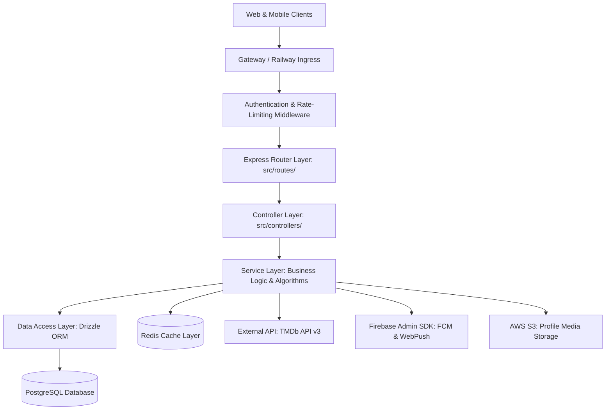
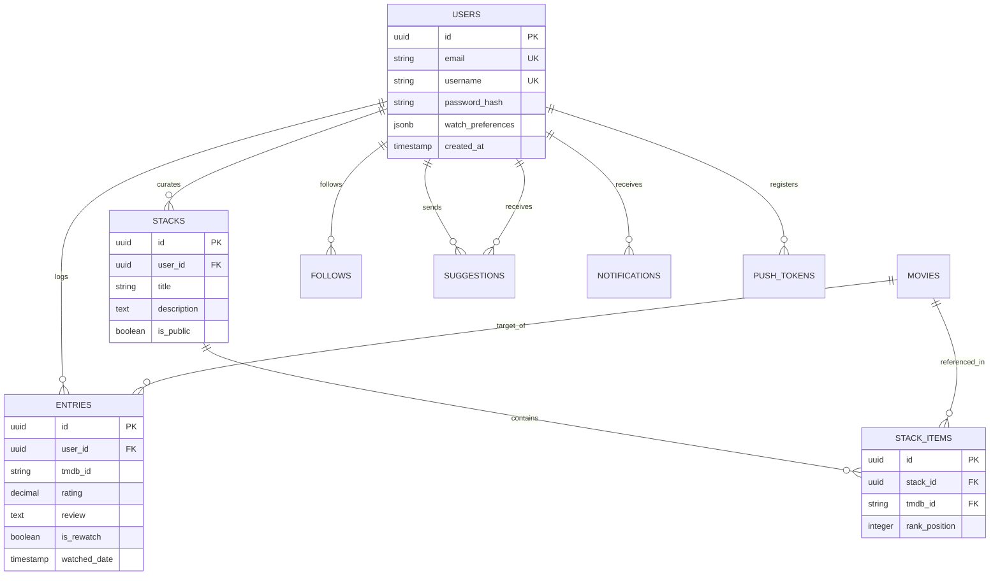

# WatchHive Backend Architecture & Engineering Blueprint 🎬🛠️

> **The Definitive Engineering & Architectural Reference for WatchHive Backend API**  
> *Targeted for Backend Engineers, System Architects, and AI Pair Programming Agents.*  
> *Covers Express.js routing, Drizzle ORM models, PostgreSQL schema relationships, Redis caching, JWT auth rotation, FCM/Web Push subsystems, and CI/CD deployment pipelines.*

---

## 🏛️ 1. High-Level Architectural Topology

WatchHive Backend is built with **Node.js (v20+ ES Modules)**, **Express.js**, and **TypeScript**, structured in a modular Controller-Service-Repository pattern:



---

## 📂 2. Directory Layout & Module Responsibilities

```
src/
├── config/                 # Environment variables, database connection, Firebase/S3 configs
│   ├── db.ts               # Drizzle ORM & Postgres client pool setup
│   ├── env.ts              # Type-safe environment validation
│   └── firebase.ts         # Firebase Admin SDK initialization
├── controllers/            # Request intake, input validation, HTTP response formatting
│   ├── authController.ts   # Login, registration, token refresh, password resets
│   ├── entryController.ts  # Watch logging, rating submissions, reviews
│   ├── feedController.ts   # Social feeds, likes, comments, friend activity
│   ├── listController.ts   # Stacks, watchlists, ranked movie collections
│   ├── mindlensController.ts# Shannon entropy telemetry & taste analytics
│   └── suggestionController.ts# Peer movie suggestions & impact scoring
├── db/                     # Database schema definitions and migration configurations
│   ├── schema/             # Drizzle PostgreSQL schema tables & relational joins
│   │   ├── users.ts        # Users, auth profiles, and preferences
│   │   ├── entries.ts      # Watch logs, ratings, reviews, tags
│   │   ├── movies.ts       # Cached movie/TV show metadata
│   │   ├── stacks.ts       # Stacks and StackItems (reorderable ranks)
│   │   ├── follows.ts      # Social graph (follower/following edges)
│   │   ├── suggestions.ts  # Movie suggestions & thank-you impact marks
│   │   └── notifications.ts# Notifications & device push tokens
│   └── migrations/         # Generated SQL migration files (drizzle-kit)
├── middleware/             # Express middlewares
│   ├── auth.ts             # JWT Bearer token validation and user hydration
│   ├── errorHandler.ts     # Centralized error response & HTTP status mapping
│   ├── rateLimiter.ts      # Redis/Memory sliding window rate limiting
│   └── validation.ts       # Zod / schema payload validation
├── routes/                 # Express route definitions
├── services/               # Core business logic and algorithmic computation
│   ├── auth.service.ts     # Token issuance, OAuth validation, password hashing
│   ├── mindlens.service.ts # Shannon entropy math, Bayesian trust engine
│   ├── notification.service.ts# Push notification dispatch (FCM + WebPush)
│   ├── tmdb.service.ts     # The Movie Database API client with caching
│   └── suggestion.service.ts# SmartSuggest hybrid scoring algorithms
└── utils/                  # Helper utilities, logger, math formulas
```

---

## 🗄️ 3. Database Architecture & Schema Relationships

WatchHive uses **PostgreSQL** managed with **Drizzle ORM** for end-to-end type safety:



---

## 🔐 4. Authentication & Security Architecture

1. **Stateless JWT Rotation**:
   - Short-lived Access Token (15–60 minutes) delivered via `Authorization: Bearer <token>`.
   - Long-lived Refresh Token (30 days) stored securely in HTTP-only cookies or native mobile encrypted storage.
2. **Password Security**:
   - `bcryptjs` salted hashing ($10+$ rounds).
   - Secure forgot password flow with cryptographic time-limited tokens and automated email delivery.
3. **OAuth 2.0 Identity Federation**:
   - Google Sign-In (`google-auth-library` ID token verification).
   - Apple Sign-In (`apple-signin-auth` identity token verification).
4. **Secret Protection**:
   - Automated git scan (`gitleaks` & `devsecops.yml`) ensuring zero credentials or private keys are ever leaked into client bundles or public commits.

---

## 🧠 5. Algorithmic Intelligence Subsystems

* **MindLens 2.0 Behavioral Intelligence Engine**:
  - Implements Shannon Information Entropy ($H(G) = -\sum_{i=1}^n p(g_i) \log_2 p(g_i)$) across user genre consumption.
  - Computes Russell's Circumplex Affective State coordinates (Valence vs. Arousal).
  - Updates Empirical Bayesian Recommender Trust ($RTS$) based on suggestion acceptance rates.
  - *Full mathematical specification documented in [MINDLENS_SPECIFICATION.md](file:///Users/adityadasamantharao/Documents/Repos/WatchHive-Backend/docs/MINDLENS_SPECIFICATION.md).*
* **Master Features & Logic Wiki**:
  - Documents all 14 core system features, scoring algorithms, and database behaviors in [FEATURES_AND_LOGIC_WIKI.md](file:///Users/adityadasamantharao/Documents/Repos/WatchHive-Backend/docs/FEATURES_AND_LOGIC_WIKI.md).

---

## 🚀 6. Deployment & CI/CD Pipeline

- **Hosting**: Railway Containerized Infrastructure.
  - `WatchHive-Backend (Staging)`: Continuous auto-deploy from `staging` branch.
  - `WatchHive-Backend (Production)`: Continuous auto-deploy from `main` branch.
- **Database Migrations**:
  ```bash
  npm run db:generate   # Generate Drizzle migration files from schema
  npm run db:migrate    # Apply pending migrations to PostgreSQL
  ```
- **Branch Protection & Review**:
  - Direct pushes to `main` are protected. All feature and bugfix work passes through `staging` via pull request and automated CI test validation.
