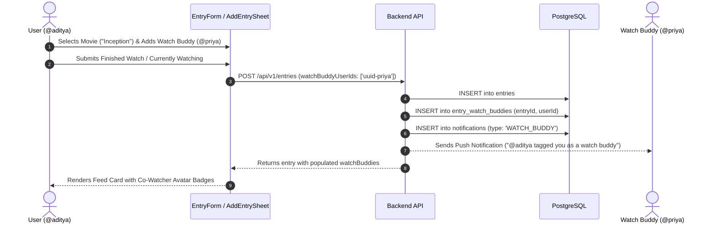
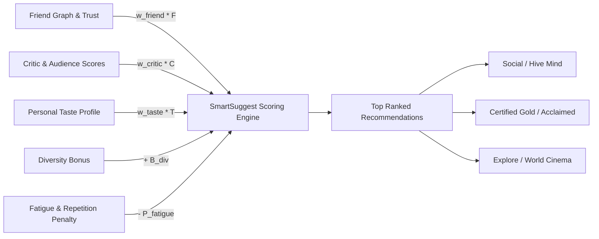

# WatchersHive Master Features & Logic Wiki 🎬📚

> **The Definitive Product, Feature, and Architectural Reference for the WatchersHive Ecosystem.**  
> Covers user experience flows, mathematical models, architectural design, database schemas, API contracts, edge-case handling, design tokens, and compliance protocols across Web, iOS, Android, and Backend.
>
> *Note: This document is stored in the `docs/` directory and is completely excluded from client and mobile application production bundles (zero impact on binary size).*

---

## Table of Contents
1. [Core Platform Philosophy](#1-core-platform-philosophy)
2. [User Authentication & Session Management](#2-user-authentication--session-management)
3. [Watch Tracking & Entry Logging Engine](#3-watch-tracking--entry-logging-engine)
4. [Currently Watching Shelf & Live Sessions](#4-currently-watching-shelf--live-sessions)
5. [Granular TV Season & Episode Tracking Engine](#5-granular-tv-season--episode-tracking-engine)
6. [Social Co-Watching & Watch Buddies](#6-social-co-watching--watch-buddies)
7. [Curated Watchlists & Recommender Attribution](#7-curated-watchlists--recommender-attribution)
8. [Ranked Lists & Stacks (The Cinephile Report Card)](#8-ranked-lists--stacks-the-cinephile-report-card)
9. [The Hive Feed & Social Graph](#9-the-hive-feed--social-graph)
10. [Direct Movie Suggestions & Gratitude Loop](#10-direct-movie-suggestions--gratitude-loop)
11. [SmartSuggest Recommendation Engine (AI Engine)](#11-smartsuggest-recommendation-engine-ai-engine)
12. [MindLens 2.0: Behavioral Intelligence & Telemetry](#12-mindlens-20-behavioral-intelligence--telemetry)
13. [QR Code Scanning, Deep Linking & Universal App Links](#13-qr-code-scanning-deep-linking--universal-app-links)
14. [Gamification, Honey Badges & Cinephile XP](#14-gamification-honey-badges--cinephile-xp)
15. [Offline-First Architecture & Sync Protocol](#15-offline-first-architecture--sync-protocol)
16. [Legal, Privacy & Global Compliance Architecture](#16-legal-privacy--global-compliance-architecture)
17. [Reactive State & Real-Time Sync Architecture](#17-reactive-state--real-time-sync-architecture)
18. [Master Design System & The Golden Contrast Rule](#18-master-design-system--the-golden-contrast-rule)
19. [Mobile-Responsive Web & PWA UX](#19-mobile-responsive-web--pwa-ux)

---

## 1. Core Platform Philosophy

**WatchersHive** is a community-driven cinematic social network designed for passionate movie, TV show, anime, and K-drama enthusiasts. Unlike traditional static databases (IMDb) or text-heavy review sites (Letterboxd), WatchersHive integrates:
- **Fast, frictionless logging** distinguishing finished watches from currently active viewing sessions.
- **Curated, drag-and-drop ranked stacks** that serve as a user's cinematic report card and taste showcase.
- **Closed-loop social recommendations** with explicit recommender attribution and gratitude tracking.
- **Social co-watching** with taggable Watch Buddies across viewing history.
- **Granular episode-level TV progress** with one-tap batch catch-up and friends' synchronized viewing indicators.
- **Empirical behavioral intelligence (MindLens 2.0)** analyzing cognitive diversity, mood shifts, and taste evolution using information theory rather than arbitrary horoscopes.
- **Proprietary recommendation engine (SmartSuggest)** balancing peer trust, critical consensus, world cinema discovery, and fatigue avoidance.
- **100% Legal & privacy compliance** with full GDPR/CCPA data export, one-click account deletion, and Apple App Store Guideline 1.2 UGC moderation.

---

## 2. User Authentication & Session Management

WatchersHive utilizes a **100% Passwordless Authentication Architecture**. Passwords have been completely eliminated to protect users against credential stuffing, phishing, and password fatigue, while eliminating forgotten password flows.

### 2.1 Passwordless 6-Digit Email OTP
- **Frictionless Entry**: The user simply enters their email address.
- **OTP Generation & Security**: The backend generates a cryptographically random 6-digit numeric code with a 10-minute expiry window, hashed in PostgreSQL (`email_verification_codes` table).
- **Delivery**: The code is dispatched instantly via SMTP/Resend.
- **Unified Sign-in & Registration**: Entering the correct 6-digit code automatically provisions a new account if the user is first-time, or logs them straight into their existing profile.
- **Inherent Email Verification**: Because logging in requires inbox access, every user is verified by definition (`isEmailVerified = true`), satisfying strict security requirements with zero extra friction.

### 2.2 Third-Party Identity Providers (SSO)
- **Google Sign-In**: Multi-platform OAuth 2.0 verification supporting Web, Android, and iOS client IDs. Verifies ID tokens via `google-auth-library` with automated fallback to Google's tokeninfo endpoint.
- **Apple Sign-In**: Cryptographic validation of Apple identity tokens (`sub` identity claims), capturing the user's name on initial authorization.

### 2.3 Multi-Platform JWT Architecture & Session Lifecycle
- **Stateless Tokens**: The backend issues a short-lived **Access Token** (7 days) and a long-lived **Refresh Token** (90 days).
- **Zero-DB Micro-Request Overhead**: Access tokens are verified purely statelessly via HMAC-SHA256 signature and expiration checks. No database query occurs on routine requests, preventing API bottlenecks and eliminating unwanted session drops.
- **Web Storage**: Access tokens are kept in client storage with refresh tokens persisted in HTTP-only, secure, SameSite cookies to defend against XSS.
- **Mobile Storage**: Mobile clients persist tokens in encrypted hardware keystores (`flutter_secure_storage` utilizing iOS Keychain and Android AES KeyStore).
- **Silent Refresh**: HTTP interceptors (`Axios` on Web, `Dio` on Mobile) intercept `401 Unauthorized` responses and initiate single-flight token renewal before seamlessly replaying pending requests without disturbing the user.
- **Global Session Revocation**: Enforced at the `/api/v1/auth/refresh` boundary using database `tokenVersion`. When a user requests a global logout or security reset, outdated refresh tokens are immediately blocked from generating new access tokens.

### 2.4 Multi-Device Session Resilience
- Standard logins and single-device logouts **do not** increment the user's global `tokenVersion`. This ensures that logging into a tablet, work laptop, or secondary mobile device does not terminate sessions on existing devices.
- Explicit "Log Out All Devices" security actions bump `tokenVersion`, invalidating all active refresh tokens globally across the cluster.

### 2.5 Guest & Public Catalog Browsing
- Catalog endpoints (`/movie/:id`, `/tv/:id`, `/popular`, `/trending`, `/recommendations`, `/search/*`) and public profiles (`/profile/:id`, `/u/:username`) utilize `optionalAuthMiddleware`.
- Unauthenticated visitors can view movie details, reviews, public ranking stacks, and user profiles without hitting login walls or modal blockers, maximizing organic search discovery and shareability.

### 2.6 Initial Loading & Logo Splash
- During authentication resolution, both web and mobile clients display a centered, pulsing brand logo (`WHAppLogoLoader`) preventing flashes of unauthenticated landing pages or abrupt layout shifts.

### 2.7 Force & Soft App Updates
- The `/api/v1/app/version` route checks client semantic versions against required minimum versions.
- If a client version falls below minimum requirements, a non-dismissible `AppUpdateDialog` directs the user to the Google Play Store, Apple App Store, or web app reload.

---

## 3. Watch Tracking & Entry Logging Engine

The entry engine represents the central data capture mechanism of the platform.

### 3.1 Metadata Resolution & High-Performance TMDb SWR Caching
- TMDb (The Movie Database) serves as the primary metadata provider.
- **Zero-Barrier Public Catalog**: Catalog endpoints use `optionalAuthMiddleware`. Public browsing never fails or prompts for logins, while authenticated user context is preserved when available.
- **Single-Flight Deduplication**: The backend prevents duplicate outbound requests to TMDb by deduplicating concurrent lookups for the same media ID in flight.
- **Stale-While-Revalidate (SWR) Caching**: Media responses are cached downstream and at the edge (`Cache-Control: public, max-age=86400, s-maxage=86400, stale-while-revalidate=43200`) providing millisecond page loads.
- **Resilient Fallback**: If TMDb is temporarily unreachable, in-memory caches and fallback providers ensure the UI never renders blank or "Untitled" placeholders.

### 3.2 Dual-Mode Watch Statuses
- **FINISHED (`WATCHED`)**: Represents completed watches. Requires a watched date.
- **CURRENTLY WATCHING (`WATCHING`)**: Represents active viewing sessions (e.g. ongoing TV seasons or paused movies).

### 3.3 Accurate Watch Timing Engine (`startedAt` + `watchedAt`)
- Entries support dual timestamp capture:
  - `startedAt`: The date and time viewing commenced.
  - `watchedAt`: The date and time viewing concluded.
- **"I don't remember when I started" Option**: Users logging historical or retro watches can check an option to omit `startedAt`, ensuring records reflect exact knowledge without forcing inaccurate arbitrary guesses.
- **Automatic Duration Calculation**: When both timestamps are provided, the platform automatically derives total viewing span, supporting binge duration insights in MindLens.
- **Clamped Time Pickers**: UI date/time pickers enforce logical temporal bounds (e.g., `watchedAt` cannot precede `startedAt`, and neither can be set to the future).

### 3.4 Universal Rating Scale & Parity
- **Scale**: Users rate titles on a **1 to 10** scale (represented as 0.5 to 5.0 honey stars with half-star increments).
- **Card & User Rating Parity**: User ratings are strictly normalized and identical between the input picker, feed cards, detail pages, and profile summaries.

### 3.5 Reviewing, Spoiler Masking & Viewing Context
- **Spoiler Flag**: Reviews flagged as spoilers are visually masked with blur effects and require an explicit click to reveal.
- **Viewing Context Tags**: Users tag their viewing location from presets (Cinema, Home, Netflix, Prime Video, Disney+ Hotstar, Apple TV+, Crunchyroll, Physical Media, etc.).
- **Viewing Formats**: Tags support IMAX, 3D, 4K UHD, and Dolby Cinema attribution.

### 3.6 Duplicate Watch Detection & TV Series Transitioning
- If a user attempts to log a finished watch for a movie they have already reviewed, an alert displays the previous watch date and rating, allowing them to choose between creating a **Rewatch** or updating their previous entry.
- When finishing a TV show that is currently in the **Currently Watching** state, the system smoothly transitions the existing active entry to finished status rather than throwing an `ALREADY_WATCHED` duplicate conflict error.

---

## 4. Currently Watching Shelf & Live Sessions

### 4.1 Purpose & Visual Placement
- The "Currently Watching" shelf is surfaced prominently at the top of the user profile, entries tab, and feed screen, highlighting ongoing cinema/series engagements.

### 4.2 Move to Watched Transition
- Users can tap a quick-action button on any currently watching card to open the "Finish Watch" modal.
- The modal automatically pre-fills the `startedAt` date from when the session began and sets `watchedAt` to the current moment, streamlining rating and review completion.

---

## 5. Granular TV Season & Episode Tracking Engine

WatchersHive features a dedicated, high-granularity episode tracking subsystem for episodic content.

```mermaid
flowchart TD
    ShowDetails[TV Show Details Screen] --> EpisodesTab[Season & Episode Picker]
    EpisodesTab --> ToggleEp[Toggle Single Episode Watched]
    EpisodesTab --> BatchCatchUp[One-Tap Batch Catch-Up]
    
    ToggleEp --> EpTable[(episode_watches Table)]
    BatchCatchUp --> EpTable
    
    EpTable --> ComputeProg[Compute Completion % & Next Up]
    ComputeProg --> ContCarousel[Continue Watching Carousel on Feed]
    ComputeProg --> FriendsBar[Friends Progress Bar on Show Details]
    
    ComputeProg --> CompletionCheck{Season or Series Complete?}
    CompletionCheck -->|Yes| AutoFinishModal[AddEntrySheet Prompt: Log Review & Rating]
    CompletionCheck -->|No| ReadyNext[Surface Next Episode S{x}E{y}]
```

### 5.1 Episode Logging & Status
- **Single Episode Toggle**: Users can drill down into individual seasons and check off specific episodes as watched (`POST /api/v1/shows/:tmdbId/episodes/watch`).
- **Episode Metadata**: Stores `seasonNumber`, `episodeNumber`, `episodeName`, optional individual episode rating, review, and `watchedAt` timestamp in `episode_watches`.
- **Feed Broadcasting**: Users can selectively toggle `postToFeed` per episode watch.

### 5.2 One-Tap Batch Catch-Up
- Users jumping into an ongoing series or syncing past progress can tap **"Catch up to this episode"** (`POST /api/v1/shows/:tmdbId/episodes/batch-catch-up`).
- Idempotently marks all prior episodes across all previous seasons and up to the target episode in the selected season as watched in a single server transaction.

### 5.3 Live Show Progress Metrics
- `GET /api/v1/shows/:tmdbId/progress` calculates real-time viewing statistics:
  - `totalEpisodesWatched`: Total count of checked-off episodes.
  - `totalEpisodesCount`: Total broadcast episodes from TMDb.
  - `progressPercentage`: Integer percentage ($0-100\%$).
  - `currentSeason`: Most recently watched season.
  - `nextEpisodeUp`: Calculated object holding the next uncompleted episode (`seasonNumber`, `episodeNumber`, `name`, `airDate`).

### 5.4 Continue Watching Carousel
- Highlighted on the Feed and Entries screens.
- Displays active series with a prominent **"Next Up: S{x}E{y}"** button.
- Tapping **"Mark Watched"** on the card instantly checks off the next episode, advances the progress bar, and calculates the subsequent episode without requiring a screen navigation.

### 5.5 Friends' Synchronized Viewing Progress
- `GET /api/v1/shows/:tmdbId/friends-progress` checks mutual follows:
  - Displays avatar badges alongside episode lists (e.g., *"@alex is on S03E04"*, *"@priya finished Season 2"*).
  - Prevents accidental spoilers during discussions and helps friends coordinate group watch-alongs.

### 5.6 Automatic Season & Series Completion
- Checking off the final episode of a season or the series finale automatically triggers the `AddEntrySheet` modal pre-filled with the series metadata, prompting the user to leave their overall series rating and review.

---

## 6. Social Co-Watching & Watch Buddies

WatchersHive allows users to tag mutual friends as **Watch Buddies** on any movie or TV show entry, capturing shared memories and collaborative cinephile history.



### 6.1 Tagging Workflow
- When logging a finished watch or currently watching entry (via `AddEntrySheet` on Mobile or `EntryForm` on Web), an expandable **"Watched With (Watch Buddies)"** selector is available.
- Users can search and select one or multiple mutual friends.
- Stored relationally in the `entry_watch_buddies` join table (`entry_id`, `user_id`, `created_at`).

### 6.2 Notification & Discovery
- Tagged buddies receive an instant push notification: *"@username tagged you as a watch buddy for [Title]"*.
- Tapping the notification deep-links directly to the entry details.

### 6.3 Feed & Profile Presentation
- Feed cards, entry detail pages, and profile lists render dedicated **Watch Buddy Avatar Pills** (e.g. *"Watched with @priya and @marco"*).
- Tapping a buddy's chip navigates directly to their user profile.

### 6.4 Edit & Retroactive Tagging
- Users can add, edit, or remove watch buddies at any time when editing an existing entry (`PUT /api/v1/entries/:id`).
- Backend guarantees idempotent join updates without orphan records.

---

## 7. Curated Watchlists & Recommender Attribution

### 7.1 Recommender Attribution
- When a user adds a movie to their watchlist from a friend's recommendation or a QR code scan, the `suggestedByUserId` is persisted alongside the watchlist item.
- When the user eventually logs the movie, the original suggester receives credit, gratitude notifications, and a boost to their **Suggester Trust Score**.

### 7.2 Reactive Watchlist Architecture
- State is managed reactively via `watchlistProvider` (Mobile) and `WatchlistContext` (Web).
- Bookmarking a title anywhere (feed card, search result, movie details, or deck sheet) updates all bookmark icons across all screens instantly without a network roundtrip.
- On mobile, if offline, changes are written to the local SQLite database and queued in an offline sync table to replay once network connectivity resumes.

---

## 8. Ranked Lists & Stacks (The Cinephile Report Card)

### 8.1 Concept & Purpose
- Stacks are ordered, themed collections (e.g., *"Top 10 Sci-Fi Mind Benders"*, *"2026 Oscar Contenders"*, *"Favorite Denis Villeneuve Films"*).
- Unlike generic playlists, stacks represent a definitive, numbered ranking.
- **Curated Stack Limit**: Users can create up to **5 custom ranking stacks**, encouraging thoughtful curation over discarded collections.

### 8.2 Drag-and-Drop Reordering
- Mobile clients use reorderable lists with tactile haptic feedback.
- Web clients employ accessible drag handles with pointer event tracking.
- Position updates are persisted in a single batch reordering transaction on the backend (`/api/v1/lists/:id/reorder`).

### 8.3 Guaranteed Stack Selection
- Tapping "Edit Stack" on a specific ranking stack passes the unique stack ID and reliably opens that exact stack for modifications, eliminating random stack selection bugs.

### 8.4 Visibility Controls & Sharing
- **Public**: Discoverable in Hive Search, profile pages, and shared web links.
- **Friends Only**: Visible only to mutual followers.
- **Private**: Visible strictly to the list creator.
- Every stack can generate a shareable image card and direct QR code for quick export.

---

## 9. The Hive Feed & Social Graph

### 9.1 Chronological & Personalized Aggregation
- Combines watch logs, reviews, rewatches, and stack creations from followed users.
- Includes cursor-based and page-based pagination to support smooth infinite scrolling.

### 9.2 Interactions: Brand-Themed Likes & Threaded Comments
- **Likes**: Optimistic toggle with counter debouncing. Styled in accordance with the **Golden Contrast Rule** (warm honey gold active states rather than generic red/blue).
- **Comments**: Full threaded discussions with notification alerts delivered to the entry author and mentioned users.

### 9.3 Follow Graph & Mutual Discovery
- Bilateral or unilateral follow relationships with real-time follower/following counts.
- **Who to Follow Widget**: Recommends users based on shared favorite genres, high-impact suggesters, and mutual connections.

---

## 10. Direct Movie Suggestions & Gratitude Loop

### 10.1 Peer-to-Peer Suggestion Flow
- Users can suggest any movie or TV show to one or multiple friends simultaneously, accompanied by a custom message.
- Pushes instant web notifications and mobile heads-up push notifications via FCM.

### 10.2 Grouped Suggestion Inbox
- Received suggestions are automatically grouped by movie title. If three different friends recommend *Interstellar*, it appears as one cohesive movie card showing all three recommenders and their personal notes.
- **Streamlined Inbox**: The redundant "Suggest" button has been removed from the Suggestions tab across all platforms, focusing the tab cleanly on incoming recommendations and smart discovery.

### 10.3 The Gratitude Loop
- When a user logs a suggested movie, the app prompts: *"Would you like to send a note of thanks to @username?"*
- Accepting this increments the recommender's **Impact Score** and feeds into their MindLens taste alignment telemetry.

---

## 11. SmartSuggest Recommendation Engine (AI Engine)

SmartSuggest is WatchersHive's proprietary recommendation system balancing social influence, critical consensus, personal taste evolution, and fatigue avoidance.



### 11.1 The Scoring Algorithm

$$S = w_{\text{friend}} \cdot F + w_{\text{critic}} \cdot C + w_{\text{taste}} \cdot T + B_{\text{diversity}} - P_{\text{fatigue}}$$

Where:
- **Friend Suggestion Score ($F$)**: Unwatched suggestions sent directly by friends (base boost $+20\%$). Multiplied by the friend's **Trust Multiplier** ($1.0\times - 1.5\times$), calculated from how frequently the user rates that friend's picks $\ge 7.5/10$.
- **Critic & Consensus Score ($C$)**: Weighted composite of TMDb vote average and audience acclaim (normalized $0-1.0$, weighted up to $30\%$).
- **Taste Profile Match ($T$)**: Match percentage against the user's historically preferred genres ($20\%$).
- **Palate Cleanser Bonus ($B_{\text{diversity}}$)**: $+10\%$ bonus if the candidate title belongs to a genre contrasting with the user's most recently watched movie.
- **Fatigue Penalty ($P_{\text{fatigue}}$)**: $-15\%$ deduction if the title matches the exact genre or director of the last watched entry, avoiding repetitive binging.

### 11.2 The 3 Distinct Recommendation Modes
1. **Hive Mind (Social Mode)**: Strongly amplifies friend suggestions and recommendations from mutual connections and trusted tastemakers.
2. **Certified Gold (Critic Mode)**: Prioritizes critical acclaim, awards recognition, and high audience consensus, pulling standout titles from the user's unwatched watchlist and global masterpieces.
3. **Explore Mode (World Cinema & Discovery)**: Deliberately surfaces high-rated international and indie cinema aligned with the user's preferred languages and genres, encouraging discovery outside the mainstream bubble.

### 11.3 Strict Watch History Exclusion Guarantee
- **Zero-Overlap Guarantee**: None of the three modes will ever suggest a title that the user has already marked as **Watched** or is currently **Watching**.
- **Regeneration with Diversity Pool**: Clicking "Regenerate" seeds a randomized query and passes active candidate IDs to `excludeIds`, ensuring that each regeneration produces at least 10 completely fresh titles.

### 11.4 The 3 UI Touchpoints
1. **Feed Hero Spark Card (`SmartSuggestHeroCard`)**: Dismissible banner at the top of the feed featuring quick mode pills, a shuffle button, match score %, and direct watchlist toggle.
2. **Interactive Decision Deck (`SmartSuggestDeckModal` / `SmartSuggestDeckSheet`)**: Full modal/bottom sheet offering swipeable card decks, complete backdrops, explainability breakdowns, and pre-filled watch logging.
3. **Suggestions Hub Integration (`SuggestionsTab`)**: Dedicated sub-tab alongside Received and Sent suggestions with search and genre filtering.

---

## 12. MindLens 2.0: Behavioral Intelligence & Telemetry

MindLens provides mathematical reflections of viewing behavior based on academic literature (Shannon Information Theory, Zillmann's Mood Management, and Russell's Circumplex Affective Model).

### 12.1 Taste Diversity via Shannon Entropy ($H(G)$)

$$H(G) = -\sum_{i=1}^{K} p(g_i) \log_2 p(g_i)$$

- Measures whether a user is a **Genre Specialist** ($H(G) < 2.0$) or an **Eclectic Polymath** ($H(G) \ge 3.2$).

### 12.2 Russell's Circumplex Affective State
- Maps recent watches onto a 2D Cartesian plane:
  - **Valence (X-axis)**: Unpleasant ($-1.0$) to Pleasant ($+1.0$).
  - **Arousal (Y-axis)**: Deactivated / Calm ($-1.0$) to Activated / Intense ($+1.0$).

### 12.3 The 6 Cognitive Viewing Archetypes
Based on entropy and mood distribution:
1. **Cinema Polymath**: High entropy across diverse eras and languages.
2. **Deep Diver**: High concentration in 1-2 specific genres or director filmographies.
3. **Adrenaline Seeker**: Predominance of high-arousal genres (Action, Thriller, Horror).
4. **Comfort Voyager**: Consistent positive-valence, moderate-arousal viewing (Animation, Comedy, Feel-Good).
5. **Cerebral Analyst**: High proportion of complex dramas, mysteries, and documentaries.
6. **Contrarian Explorer**: Frequent divergence from critical consensus with high variance in personal ratings.

---

## 13. QR Code Scanning, Deep Linking & Universal App Links

### 13.1 Deep Link URIs
| Entity | Deep Link Path | Web Equivalent |
| :--- | :--- | :--- |
| **User Profile** | `watchhive://profile/:id` or `/u/:username` | `https://watchershive.com/u/:username` |
| **Movie Details** | `watchhive://details/:type/:tmdbId` | `https://watchershive.com/watch-hive/details/:type/:tmdbId` |
| **Ranked Stack** | `watchhive://stack/:id` | `https://watchershive.com/watch-hive/stack/:id` |

### 13.2 Universal & App Links Setup
- **Android**: Configured via `assetlinks.json` hosted at `/.well-known/assetlinks.json` matching SHA256 fingerprints.
- **iOS**: Configured via `apple-app-site-association` (AASA) hosted at `/.well-known/apple-app-site-association`.
- **External Camera Scan Fallback**: If a user scans a WatchersHive QR code using a phone camera or Google Lens:
  - If the app is installed, OS App Links launch the native mobile app directly to the target movie/profile.
  - If opened in an external web browser, a responsive **"Open in App"** smart banner appears with a one-tap deep link trigger to switch into the installed app.

---

## 14. Gamification, Honey Badges & Cinephile XP

### 14.1 XP Calculation Algorithm
XP (Experience Points) rewards constructive social curation rather than mindless consumption:
- **Log Watch**: $+20\text{ XP}$
- **Detailed Review ($\ge 100$ characters)**: $+30\text{ XP}$
- **Create Ranked Stack**: $+50\text{ XP}$
- **Accepted Suggestion (Friend Watched Your Pick)**: $+75\text{ XP}$
- **Daily Streak Maintenance**: $+15\text{ XP}$

### 14.2 Honey Badges System
Badges represent milestones unlocked through verified platform activity:
- **Hive Pioneer**: Early platform adopter.
- **Genre Specialist / Polymath**: Unlocked via MindLens Shannon Entropy thresholds.
- **Trusted Suggester**: Maintained when 5+ friends rate suggested movies $\ge 8.0$.
- **Marathoner**: Logging 5+ entries within a 48-hour window.
- **Co-Watcher**: Logging entries with tagged Watch Buddies.

---

## 15. Offline-First Architecture & Sync Protocol

### 15.1 Storage Layers
- **Mobile Client**: Relational SQLite database accessed via `sqflite`.
- **Web Client (PWA)**: Service Worker asset cache combined with IndexedDB for local watch state storage.

### 15.2 Idempotent Action Queue
- When offline, mutation requests (`ADD_ENTRY`, `TOGGLE_WATCHLIST`, `CREATE_SUGGESTION`) are assigned a UUID v4 and written to the local `offline_sync_queue` table.
- When `connectivity_plus` detects internet restoration:
  1. The queue replays mutations in chronological order.
  2. The server processes each mutation idempotently, ignoring duplicates.
  3. The local cache updates with the server's authoritative records.

---

## 16. Legal, Privacy & Global Compliance Architecture

WatchersHive is built to comply with global data protection standards (GDPR, CCPA) and platform vendor guidelines (Apple App Store Guideline 1.2, Google Play Developer Policies).

### 16.1 Global Compliance Framework
- **Terms of Service**: Explicit contract outlining permitted use, intellectual property protection, and disclaimer of video hosting or broadcasting.
- **Privacy Policy**: Clear disclosures detailing data collection (email for OTP, public username, viewing history, device tokens for push notifications).
- **Cookie & Local Storage Policy**: HTTP-only session cookies and local storage tokens used strictly for authentication and preferences; **zero third-party behavioral trackers or ad-network beacons**.

### 16.2 GDPR & CCPA User Rights
- **Right to Access & Data Portability**: Users can request a complete machine-readable archive of all their personal data (`GET /api/v1/data/export`). Returns a structured JSON export containing account details, watch history, reviews, ratings, watchlist items, ranking stacks, and social connections.
- **Right to Erasure (Account Deletion / "Danger Zone")**: Users can permanently delete their account at any time (`DELETE /api/v1/users/me`).
  - Executes a cascade deletion in PostgreSQL removing user credentials, entries, watch buddy links, comments, likes, list items, suggestions, and push device tokens.
  - Purges any uploaded profile media from storage.

### 16.3 Third-Party Media & TMDb Attributions
- **TMDb Attribution Notice**: WatchersHive uses the TMDb API for media metadata, posters, and cast listings but is not endorsed or certified by TMDb.
- **Non-Hosting & Anti-Piracy Disclaimer**: WatchersHive **does not host, stream, upload, or index video content or digital media files**. It is purely a social cataloging, rating, and discussion platform.

### 16.4 User-Generated Content (UGC) Moderation & Apple Guideline 1.2
To protect the community and satisfy Apple App Store Guideline 1.2:
- **Reporting Mechanism (`POST /api/v1/reports`)**: Every review, comment, and user profile provides a prominent "Report" flag allowing users to submit complaints regarding harassment, hate speech, spam, or explicit content.
- **Instant User Blocking (`POST /api/v1/reports/block` / `blocked_users`)**: Users can block any individual. Blocked users are immediately hidden from feeds, cannot view each other's profiles, and cannot send suggestions or comments.
- **Zero-Tolerance Policy**: Moderation triage queues flag reported items for administrative review and immediate takedown.

---

## 17. Reactive State & Real-Time Sync Architecture

To deliver an instantaneous, app-like experience without requiring manual pull-to-refresh:

### 17.1 Riverpod State Graph (Flutter Mobile)
- **`continueWatchingProvider`**: Automatically recomputes series progress and next episodes upon episode checkoff.
- **`watchlistProvider` & `reactiveIsInWatchlistProvider`**: Synchronous optimistic additions and removals across all screens; toggling a bookmark updates feed cards, detail pages, and watchlist tabs simultaneously.
- **`entriesProvider(isWatching: true/false)`**: Real-time state synchronizer separating active watching from completed watch logs.
- **`feedProvider`**: Prepends or updates entries when users log a title or watch an episode with `postToFeed: true`.
- **`myRankingsProvider` & `activeStackProvider`**: Reloads stack item counts and contents immediately upon adding titles via `AddToStackSheet`.
- **`userProfileScreen` Live Hydration**: Binds current user profile tabs ("Watches", "Watching", "Watchlist", "Badges") directly to active providers, ensuring entries logged from the FAB or movie details appear instantly.

### 17.2 React Context & SWR Client (Web PWA)
- Custom Axios client with in-memory TMDb SWR caching (10m to 24h).
- Request deduplication preventing duplicate simultaneous outbound queries.
- Optimistic watchlist and like mutations via `WatchlistContext`.

---

## 18. Master Design System & The Golden Contrast Rule

WatchersHive adheres strictly to the **Warm Honey & Cream Aesthetic** across all platforms (Web PWA, iOS, Android).

### 18.1 Master Design Tokens
| Token Name | Hex Code | Usage |
|:---|:---|:---|
| **Honey Gold (Primary)** | `#FFB700` | Brand identity, primary CTAs, active indicators, rating stars |
| **Honey Gold Light** | `#FFDA40` | Secondary highlights, badge accents |
| **Honey Gold Dark** | `#E59700` | Hover states, pressed states, borders |
| **Warm Cream (Background)** | `#FFF9F0` | Main canvas background across Web & Mobile |
| **Pure White (Surface)** | `#FFFFFF` | Elevated cards, dialogs, sheets, bottom nav |
| **Charcoal Black (Text Primary)** | `#2D2926` / `#262626` | High-contrast body, headlines, buttons |
| **Muted Grey (Text Secondary)** | `#737373` / `#525252` | Subtitles, timestamps, placeholders |
| **Border Neutral** | `#E5E5E5` / `#EAE5DE` | Card outlines, dividers |

### 18.2 The Golden Contrast Rule
> [!IMPORTANT]
> **All typography and icons over Honey Gold (`#FFB700`), Cream (`#FFF9F0`), or White (`#FFFFFF`) MUST be Charcoal Black (`#262626` / `#2D2926`).**  
> NEVER render white text on gold, amber, or cream surfaces. This rule guarantees AAA accessibility across light themes.

### 18.3 Loader Hierarchy
1. **Primary Loader**: Skeleton Loaders (`WHSkeletonBox` on mobile, skeleton shimmer classes on web). Used for all card feeds, carousels, lists, and profiles while fetching data.
2. **Secondary Loader**: WatchHive Bee Loader (`BeeLoadingScreen` / animated bee). Used **strictly** for full-page boot, initial app splash, or blocking modal submits where skeletons cannot fit.

### 18.4 Rating Scale
- **10-Point Scale**: Rates titles from **0.5 to 10.0** (0.5 increments), visualized as 5 dual-halved honey stars.

### 18.5 Story / Social Share Card Generator
- Generates 9:16 high-resolution story cards optimized for Instagram, Snapchat, and WhatsApp.
- Renders movie backdrop art, user review, rating stars, personal avatar, and deep-link QR code.

---

## 19. Mobile-Responsive Web & PWA UX

### 19.1 Breakpoint Standards
- **Mobile (< 640px)**: Single-column feed, bottom modal sheets, compact hero cards, and sticky bottom navigation.
- **Tablet (640px - 1024px)**: Expanded cards, dual-column grids, and adaptive top navigation.
- **Desktop (> 1024px)**: Three-column layout with center feed, sticky left navigation bar, and right sidebar widgets (Trending in Hive, Who to Follow).

### 19.2 Keyboard Avoidance & Non-Restricting Overlays
- All quick-add modals and reply banners calculate dynamic `viewport` heights and safe area padding (`env(safe-area-inset-bottom)`).
- Quick Add banners auto-collapse or scroll into view when virtual keyboards open, ensuring input fields and submit buttons are never obscured.

---

*This document is maintained as part of the WatchersHive core repository documentation. For feature requests or algorithmic adjustments, open a discussion in GitHub Issues.*
