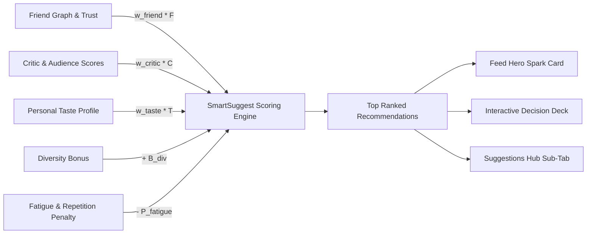

# WatchersHive Master Features & Logic Wiki 🎬📚

> **Reference Documentation for Engineers, Contributors, and Product Stakeholders.**  
> This document details every feature in the **WatchersHive** ecosystem, including user experience flows, mathematical models, architectural design, database schemas, and edge-case handling.
>
> *Note: This document is stored in the `docs/` directory and is completely excluded from production client and mobile app bundles (zero impact on app binary size).*

---

## Table of Contents
1. [Core Platform Philosophy](#1-core-platform-philosophy)
2. [User Authentication & Session Management](#2-user-authentication--session-management)
3. [Watch Tracking & Entry Logging Engine](#3-watch-tracking--entry-logging-engine)
4. [Currently Watching Shelf & Live Sessions](#4-currently-watching-shelf--live-sessions)
5. [Curated Watchlists & Attribution](#5-curated-watchlists--attribution)
6. [Ranked Lists & Stacks (The Cinephile Report Card)](#6-ranked-lists--stacks-the-cinephile-report-card)
7. [The Hive Feed & Social Graph](#7-the-hive-feed--social-graph)
8. [Direct Movie Suggestions & Gratitude Loop](#8-direct-movie-suggestions--gratitude-loop)
9. [SmartSuggest Recommendation Engine (AI Engine)](#9-smartsuggest-recommendation-engine-ai-engine)
10. [MindLens 2.0: Behavioral Intelligence & Telemetry](#10-mindlens-20-behavioral-intelligence--telemetry)
11. [QR Code Scanning, Deep Linking & Universal App Links](#11-qr-code-scanning-deep-linking--universal-app-links)
12. [Gamification, Honey Badges & Cinephile XP](#12-gamification-honey-badges--cinephile-xp)
13. [Offline-First Architecture & Sync Protocol](#13-offline-first-architecture--sync-protocol)
14. [Mobile-Responsive Web & PWA UX](#14-mobile-responsive-web--pwa-ux)

---

## 1. Core Platform Philosophy

**WatchersHive** is a community-driven cinematic social network designed for passionate movie and TV show viewers. Unlike traditional databases (IMDb) or text-heavy review sites (Letterboxd), WatchersHive integrates:
- **Fast, frictionless logging** (finished watches vs. currently watching).
- **Curated, drag-and-drop ranked stacks** that serve as a user's cinematic report card.
- **Closed-loop social recommendations** with recommender attribution and trust metrics.
- **Empirical behavioral intelligence (MindLens)** that analyzes cognitive diversity, mood shifts, and taste evolution without arbitrary horoscopes.
- **Personalized recommendation engine (SmartSuggest)** balancing friend influence, public acclaim, and fatigue avoidance.

---

## 2. User Authentication & Session Management

### 2.1 Multi-Platform JWT Architecture
- **Stateless Tokens**: The backend issues a short-lived **Access Token** (7 days default) and a long-lived **Refresh Token** (90 days).
- **Web Storage**: Access tokens are kept in memory/session with refresh tokens persisted in HTTP-only, secure, same-site cookies to defend against XSS.
- **Mobile Storage**: Mobile clients store tokens in encrypted hardware keystores (`flutter_secure_storage` using iOS Keychain and Android AES KeyStore).
- **Silent Refresh**: HTTP interceptors (`Axios` on Web, `Dio` on Mobile) detect `401 Unauthorized` responses and initiate a single-flight token refresh before retrying queued requests transparently.

### 2.2 Third-Party Identity Providers
- **Google Sign-In**: OAuth 2.0 ID Token verification on the backend (`google-auth-library`), verifying audience, issuer, and email verification flags.
- **Apple Sign-In**: Validates Apple identity tokens, extracting user names on first authentication and persisting unique `sub` identifiers.

### 2.3 Initial Loading & Logo Splash
- During authentication resolution, both web and mobile clients display a centered, pulsing brand logo (`WHAppLogoLoader`) preventing flashes of unauthenticated landing pages or abrupt layout shifts.

### 2.4 Force & Soft App Updates
- The `/api/v1/app-version` route checks client semantic versions against required minimum versions.
- If a client version falls below minimum requirements, a non-dismissible `AppUpdateDialog` directs the user to the Google Play Store, Apple App Store, or web app reload.

---

## 3. Watch Tracking & Entry Logging Engine

The entry engine represents the central data capture mechanism of the platform.

### 3.1 Metadata Resolution Pipeline
- TMDb (The Movie Database) serves as the primary metadata provider.
- **Single-Flight Deduplication**: The backend prevents duplicate outbound requests to TMDb by deduplicating concurrent lookups for the same media ID.
- **Resilient Fallback**: If TMDb is temporarily unreachable, local SQLite or cached Postgres details are used to ensure the UI never renders blank or "Untitled" placeholders.

### 3.2 Dual-Mode Watch Statuses
- **FINISHED (`WATCHED`)**: Represents completed watches. Requires a watched date.
- **CURRENTLY WATCHING (`WATCHING`)**: Represents active viewing sessions (e.g. ongoing TV seasons or paused movies).

### 3.3 Universal Rating Scale & Parity
- **Scale**: Users rate titles on a **1 to 10** scale (represented as 0.5 to 5 stars with half-star increments).
- **Card & User Rating Parity**: User ratings are strictly normalized and identical between the input picker, feed cards, detail pages, and profile summaries.

### 3.4 Reviewing, Spoiler Masking & Viewing Context
- **Spoiler Flag**: Reviews flagged as spoilers are visually masked with blur effects and require an explicit click to reveal.
- **Viewing Context Tags**: Users tag their viewing location from presets (Cinema, Home, Netflix, Prime Video, Disney+ Hotstar, Apple TV+, etc.).
- **Timestamps**: Separate tracking for `startedAt` and `watchedAt` timestamps to preserve exact viewing history.

### 3.5 Duplicate Watch Detection
- If a user attempts to log a title they have previously reviewed, an alert displays the previous watch date and rating, allowing them to choose between creating a **Rewatch** or updating their previous entry.

---

## 4. Currently Watching Shelf & Live Sessions

### 4.1 Purpose & Visual Placement
- The "Currently Watching" shelf is surfaced at the top of the user profile and entries page, highlighting ongoing cinema/series engagements.

### 4.2 Move to Watched Transition
- Users can tap a quick-action button on any currently watching card to open the "Finish Watch" modal.
- The modal automatically pre-fills the `startedAt` date and sets `watchedAt` to the current moment, streamlining the rating and review completion flow.

---

## 5. Curated Watchlists & Attribution

### 5.1 Recommender Attribution
- When a user adds a movie to their watchlist from a friend's recommendation or a QR code scan, the `suggestedByUserId` is persisted alongside the watchlist item.
- When the user eventually logs the movie, the original suggester receives credit, gratitude notifications, and a boost to their **Suggester Trust Score**.

### 5.2 Optimistic Add/Remove & Offline Enqueueing
- Watchlist toggles respond instantly in the UI.
- On mobile, if offline, changes are written to the local SQLite database and queued in an offline sync table to replay once network connectivity resumes.

---

## 6. Ranked Lists & Stacks (The Cinephile Report Card)

### 6.1 Concept & Purpose
- Stacks are ordered, themed collections (e.g., *"Top 10 Sci-Fi Mind Benders"*, *"2026 Oscar Contenders"*, *"Favorite Denis Villeneuve Films"*).
- Unlike generic playlists, stacks represent a definitive, numbered ranking.

### 6.2 Drag-and-Drop Reordering
- Mobile clients use reorderable lists with tactile haptic feedback.
- Web clients employ accessible drag handles with pointer event tracking.
- Position updates are persisted in a single batch reordering transaction on the backend (`/api/v1/lists/:id/reorder`).

### 6.3 Visibility Controls & Sharing
- **Public**: Discoverable in Hive Search, profile pages, and shared web links.
- **Friends Only**: Visible only to mutual followers.
- **Private**: Visible strictly to the list creator.
- Every stack can generate a shareable image card and direct QR code for quick export.

---

## 7. The Hive Feed & Social Graph

### 7.1 Chronological & Personalized Aggregation
- Combines watch logs, reviews, rewatches, and stack creations from followed users.
- Includes cursor-based and page-based pagination to support smooth infinite scrolling.

### 7.2 Interactions: Likes & Threaded Comments
- **Likes**: Optimistic toggle with counter debouncing.
- **Comments**: Full threaded discussions with notification alerts delivered to the entry author and mentioned users.

### 7.3 Follow Graph & Mutual Discovery
- Bilateral or unilateral follow relationships with real-time follower/following counts.
- **Who to Follow Widget**: Recommends users based on shared favorite genres, high-impact suggesters, and mutual connections.

---

## 8. Direct Movie Suggestions & Gratitude Loop

### 8.1 Peer-to-Peer Suggestion Flow
- Users can suggest any movie or TV show to one or multiple friends simultaneously, accompanied by a custom message.
- Pushes instant web notifications and mobile heads-up push notifications via FCM.

### 8.2 Grouped Suggestion Inbox
- Received suggestions are automatically grouped by movie title. If three different friends recommend *Interstellar*, it appears as one cohesive movie card showing all three recommenders and their personal notes.

### 8.3 The Gratitude Loop
- When a user logs a suggested movie, the app prompts: *"Would you like to send a note of thanks to @username?"*
- Accepting this increments the recommender's **Impact Score** and feeds into their MindLens taste alignment telemetry.

---

## 9. SmartSuggest Recommendation Engine (AI Engine)

SmartSuggest is WatchersHive's proprietary recommendation system balancing social influence, critical consensus, personal taste evolution, and fatigue avoidance.

### 9.1 The Scoring Algorithm

$$S = w_{\text{friend}} \cdot F + w_{\text{critic}} \cdot C + w_{\text{taste}} \cdot T + B_{\text{diversity}} - P_{\text{fatigue}}$$

Where:
- **Friend Suggestion Score ($F$)**: Unwatched suggestions sent directly by friends (base boost $+20\%$). Multiplied by the friend's **Trust Multiplier** ($1.0\times - 1.5\times$), calculated from how frequently the user rates that friend's picks $\ge 7.5/10$.
- **Critic & Consensus Score ($C$)**: Weighted composite of TMDb vote average and audience acclaim (normalized $0-1.0$, weighted up to $30\%$).
- **Taste Profile Match ($T$)**: Match percentage against the user's historically preferred genres ($20\%$).
- **Palate Cleanser Bonus ($B_{\text{diversity}}$)**: $+10\%$ bonus if the candidate title belongs to a genre contrasting with the user's most recently watched movie.
- **Fatigue Penalty ($P_{\text{fatigue}}$)**: $-15\%$ deduction if the title matches the exact genre or director of the last watched entry, avoiding repetitive binging.

### 9.2 Recommendation Modes
1. **Hive Mind (Social Mode)**: Strongly amplifies friend suggestions and picks from trusted tastemakers.
2. **Certified Gold (Critic Mode)**: Prioritizes critical acclaim, awards recognition, and high audience consensus.
3. **Palate Cleanser (Explore Mode)**: Deliberately steers the user toward under-explored genres outside their comfort zone.

### 9.3 The 3 UI Touchpoints
1. **Feed Hero Spark Card (`SmartSuggestHeroCard`)**: Dismissible banner at the top of the feed featuring quick mode pills, a shuffle button, match score %, and direct watchlist toggle.
2. **Interactive Decision Deck (`SmartSuggestDeckModal` / `SmartSuggestDeckSheet`)**: Full modal/bottom sheet offering swipeable card decks, complete backdrops, explainability breakdowns, and pre-filled watch logging.
3. **Suggestions Hub Integration (`SuggestionsTab`)**: Dedicated sub-tab alongside Received and Sent suggestions with search and genre filtering.

---

## 10. MindLens 2.0: Behavioral Intelligence & Telemetry

MindLens provides mathematical reflections of viewing behavior based on academic literature (Shannon Information Theory, Zillmann's Mood Management, and Russell's Circumplex Affective Model).

### 10.1 Taste Diversity via Shannon Entropy ($H(G)$)

$$H(G) = -\sum_{i=1}^{K} p(g_i) \log_2 p(g_i)$$

- Measures whether a user is a **Genre Specialist** ($H(G) < 2.0$) or an **Eclectic Polymath** ($H(G) \ge 3.2$).

### 10.2 Russell's Circumplex Affective State
- Maps recent watches onto a 2D Cartesian plane:
  - **Valence (X-axis)**: Unpleasant ($-1.0$) to Pleasant ($+1.0$).
  - **Arousal (Y-axis)**: Deactivated / Calm ($-1.0$) to Activated / Intense ($+1.0$).

### 10.3 The 6 Cognitive Viewing Archetypes
Based on entropy and mood distribution:
1. **Cinema Polymath**: High entropy across diverse eras and languages.
2. **Deep Diver**: High concentration in 1-2 specific genres or director filmographies.
3. **Adrenaline Seeker**: Predominance of high-arousal genres (Action, Thriller, Horror).
4. **Comfort Voyager**: Consistent positive-valence, moderate-arousal viewing (Animation, Comedy, Feel-Good).
5. **Cerebral Analyst**: High proportion of complex dramas, mysteries, and documentaries.
6. **Contrarian Explorer**: Frequent divergence from critical consensus with high variance in personal ratings.

---

## 11. QR Code Scanning, Deep Linking & Universal App Links

### 11.1 Deep Link URIs
| Entity | Deep Link Path | Web Equivalent |
| :--- | :--- | :--- |
| **User Profile** | `watchhive://profile/:id` or `/u/:username` | `https://watchershive.com/u/:username` |
| **Movie Details** | `watchhive://details/:type/:tmdbId` | `https://watchershive.com/watch-hive/details/:type/:tmdbId` |
| **Ranked Stack** | `watchhive://stack/:id` | `https://watchershive.com/watch-hive/stack/:id` |

### 11.2 Universal & App Links Setup
- **Android**: Configured via `assetlinks.json` hosted at `/.well-known/assetlinks.json` matching SHA256 fingerprints.
- **iOS**: Configured via `apple-app-site-association` (AASA) hosted at `/.well-known/apple-app-site-association`.
- **External Camera Scan Fallback**: If a user scans a WatchersHive QR code using a phone camera or Google Lens:
  - If the app is installed, OS App Links launch the native mobile app directly to the target movie/profile.
  - If opened in an external web browser, a responsive **"Open in App"** smart banner appears with a one-tap deep link trigger to switch into the installed app.

---

## 12. Gamification, Honey Badges & Cinephile XP

### 12.1 XP Calculation Algorithm
XP (Experience Points) rewards constructive social curation rather than mindless consumption:
- **Log Watch**: $+20\text{ XP}$
- **Detailed Review ($\ge 100$ characters)**: $+30\text{ XP}$
- **Create Ranked Stack**: $+50\text{ XP}$
- **Accepted Suggestion (Friend Watched Your Pick)**: $+75\text{ XP}$
- **Daily Streak Maintenance**: $+15\text{ XP}$

### 12.2 Honey Badges System
Badges represent milestones unlocked through verified platform activity:
- **Hive Pioneer**: Early platform adopter.
- **Genre Specialist / Polymath**: Unlocked via MindLens Shannon Entropy thresholds.
- **Trusted Suggester**: Maintained when 5+ friends rate suggested movies $\ge 8.0$.
- **Marathoner**: Logging 5+ entries within a 48-hour window.

---

## 13. Offline-First Architecture & Sync Protocol

### 13.1 Storage Layers
- **Mobile Client**: Relational SQLite database accessed via `sqflite`.
- **Web Client (PWA)**: Service Worker asset cache combined with IndexedDB for local watch state storage.

### 13.2 Idempotent Action Queue
- When offline, mutation requests (`ADD_ENTRY`, `TOGGLE_WATCHLIST`, `CREATE_SUGGESTION`) are assigned a UUID v4 and written to the local `offline_sync_queue` table.
- When `connectivity_plus` detects internet restoration:
  1. The queue replays mutations in chronological order.
  2. The server processes each mutation idempotently, ignoring duplicates.
  3. The local cache updates with the server's authoritative records.

---

## 14. Mobile-Responsive Web & PWA UX

### 14.1 Breakpoint Standards
- **Mobile (< 640px)**: Single-column feed, bottom modal sheets, compact hero cards, and sticky bottom navigation.
- **Tablet (640px - 1024px)**: Expanded cards, dual-column grids, and adaptive top navigation.
- **Desktop (> 1024px)**: Three-column layout with center feed, sticky left navigation bar, and right sidebar widgets (Trending in Hive, Who to Follow).

### 14.2 Keyboard Avoidance & Non-Restricting Overlays
- All quick-add modals and reply banners calculate dynamic `viewport` heights and safe area padding (`env(safe-area-inset-bottom)`).
- Quick Add banners auto-collapse or scroll into view when virtual keyboards open, ensuring input fields and submit buttons are never obscured.

---

*This document is maintained as part of the WatchersHive core repository documentation. For feature requests or algorithmic adjustments, open a discussion in GitHub Issues.*
